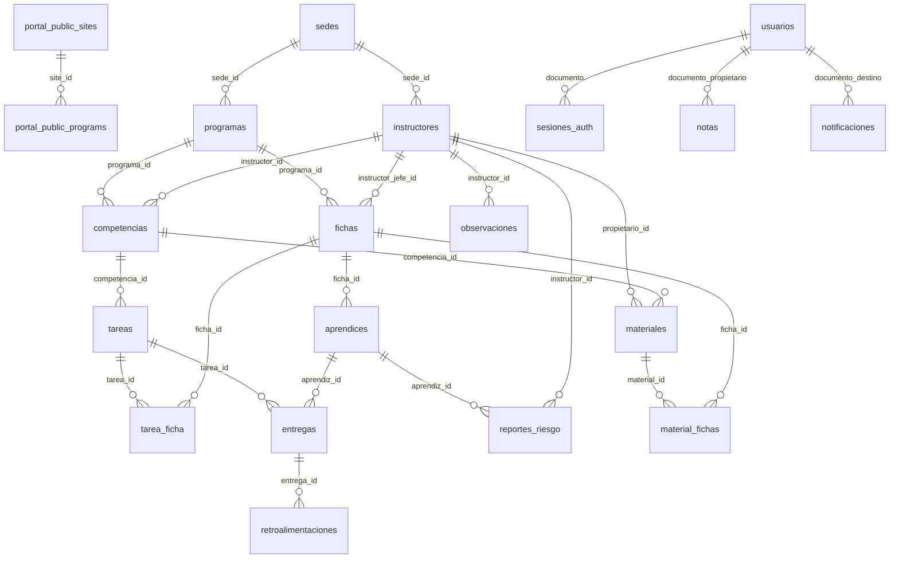

# Manual técnico, instalación y operación

**Versión:** 1.0 · **Fecha:** 26 de noviembre de 2026
**Estado:** documentación técnica basada en el repositorio; falta anexar
capturas reales de despliegue.

## 1. Arquitectura y estructura

```text
Navegador
  ├─ portafolio-digital-sena.html
  ├─ styles.css
  └─ app.js ── fetch same-origin ── Express (server/index.js)
                                      ├─ rutas privadas (server/private.js)
                                      └─ PostgreSQL/Neon (server/db.js)
```

| Ruta | Responsabilidad |
|---|---|
| `app.js` | Renderizado por rol, formularios, navegación y peticiones `fetch`. |
| `portafolio-digital-sena.html` | Login, catálogo público y contenedores de la aplicación; incluye viewport. |
| `styles.css` | Diseño visual, menú adaptable y reglas móviles. |
| `server/index.js` | Express, Helmet/CSP, CORS, catálogo público y archivos frontend permitidos. |
| `server/private.js` | Autenticación, sesiones, autorización por rol, consultas y operaciones privadas. |
| `server/db.js` | Pool `pg` y validación de URLs PostgreSQL. |
| `migrations/` | Esquemas SQL versionados: catálogo público y portafolio privado. |
| `scripts/` | Comprobación de conexión, migración, alta inicial del administrador y carga controlada de solo lectura. |
| `base_de_datos/` | Datos/esquema históricos; ignorados por Git y no servidos por Express. No son seeds del despliegue. |

> **CAPTURA T-01 — PENDIENTE**
> Archivo: `docs/capturas/15-estructura-proyecto.png`
> Debe verse: árbol de carpetas `server/`, `migrations/`, `scripts/` y `docs/`,
> además de los archivos principales.
> Validar: no expandir ni mostrar `.env.local`, `.neon`, `node_modules/` ni
> contenidos de datos históricos.

## 2. Requisitos de instalación

- Node.js **24.10 o posterior** y npm.
- Windows 10/11, macOS o Linux para desarrollo; Render ejecuta el servicio
  Node.js en su entorno Linux administrado.
- PostgreSQL compatible; en el despliegue documentado, proyecto y rama de Neon.
- Conexión de red al host de PostgreSQL.
- Para uso local: navegador moderno y estación recomendada de 2 vCPU/4 GB RAM
  como referencia práctica, no como mínimo medido.
- Para producción: hosting Node.js con HTTPS y variables secretas. No hay
  benchmark de carga ni tamaño de instancia validado; dimensionar después de
  pruebas de carga.

## 3. Variables de entorno

Configurar en `.env.local` local o en el gestor de secretos del hosting. Nunca
copiar valores reales al manual ni al repositorio.

| Variable | Uso |
|---|---|
| `DATABASE_URL` | URL PostgreSQL pooled para consultas de aplicación (`pg`). |
| `DATABASE_URL_UNPOOLED` | URL directa/no pooled para migraciones y alta inicial. |
| `NODE_ENV` | Usar `production` en hosting HTTPS; activa cookie `Secure` y nombre `__Host-...`. |
| `PORT` | Puerto de escucha; el hosting suele asignarlo. |
| `FRONTEND_ORIGINS` | Orígenes exactos separados por coma si frontend y API están en dominios distintos. Vacío para mismo origen. |
| `BOOTSTRAP_ADMIN_DOCUMENT` | Temporal, solo para crear administrador inicial. |
| `BOOTSTRAP_ADMIN_NAME` | Temporal, nombre del administrador inicial. |
| `BOOTSTRAP_ADMIN_EMAIL` | Temporal, correo del administrador inicial. |
| `BOOTSTRAP_ADMIN_PASSWORD` | Temporal, contraseña inicial de 10–128 caracteres. Retirar tras el bootstrap. |

`.env.example` contiene nombres sin secretos. `.env`, `.env.*` (excepto el
ejemplo), `.neon`, `node_modules/`, `base_de_datos/` y llaves comunes están en
`.gitignore`. Antes de publicar, revisar `git status` y `git ls-files`; no pegar
salidas de `.env.local` en tickets, capturas ni logs.

## 4. Instalación y ejecución local

Desde la raíz del proyecto:

```powershell
npm ci
if (-not (Test-Path .env.local)) { Copy-Item .env.example .env.local }
# Editar .env.local: usar NODE_ENV=development en local HTTP y secretos de desarrollo.
# No copiar credenciales productivas compartidas ni publicar este archivo.
npm run build
npm run db:check
npm run db:migrate
npm run db:create-admin
npm start
```

`npm run db:check` ejecuta `SELECT version()` con `DATABASE_URL`.
`npm run db:migrate` requiere `DATABASE_URL_UNPOOLED`, crea `schema_migrations`
y aplica los SQL numerados no registrados, en orden y transacción.
`npm run db:create-admin` inserta solo si todavía no existe administrador,
requiere las cuatro variables `BOOTSTRAP_ADMIN_*` y usa conexión directa. El
script no se ejecutó durante esta auditoría.
`npm start` carga `.env`, luego `.env.local` si existe y arranca Express.
`npm run build` ejecuta `node --check` en servidor, scripts y frontend; no
compila/bundlea ni ejecuta pruebas funcionales.

No ejecutar `db:migrate` ni `db:create-admin` contra producción durante una
prueba o revisión sin autorización explícita y una ventana de cambio.

## 5. Despliegue recomendado en Render + Neon

1. Crear un servicio Web Node conectado al repositorio.
2. Configurar Build Command: `npm ci && npm run build`.
3. Configurar Start Command: `npm start`.
4. Configurar Release/Pre-Deploy Command: `npm run db:migrate`.
5. Añadir `DATABASE_URL`, `DATABASE_URL_UNPOOLED` y `NODE_ENV=production` como
   secretos/variables del servicio. Añadir `PORT` solo si el proveedor no lo
   administra. Dejar `FRONTEND_ORIGINS` vacío para frontend/API mismo origen.
6. Aplicar una migración en el entorno destino con revisión previa. Crear el
   primer administrador en una ejecución controlada, con variables
   `BOOTSTRAP_ADMIN_*` temporales; retirarlas inmediatamente.
7. Verificar `GET /api/health`, `GET /api/health/database` y el catálogo
   `GET /api/public/catalog`. No colocar credenciales en URLs, capturas o logs.
8. Cargar datos académicos iniciales mediante el panel con autorización.

Los límites de disponibilidad, suspensión, dominio permanente y gratuidad
dependen del plan vigente de Render/Neon; el repositorio no garantiza servicio
24/7 ni costos específicos.

**Capturas pendientes:** build/deploy, variables redactadas, migración aplicada
sin mostrar URLs, servicio saludable y catálogo público.

> **CAPTURA T-02 — PENDIENTE**
> Archivo: `docs/capturas/16-render-configuracion-redactada.png`
> Debe verse: servicio Render y nombres de variables requeridas.
> Validar: ocultar todos los valores, URL de base de datos, tokens y datos de
> cuenta.

> **CAPTURA T-03 — PENDIENTE**
> Archivo: `docs/capturas/17-deploy-health-catalogo.png`
> Debe verse: deploy terminado, health check y catálogo público en navegador.
> Validar: mismos orígenes recomendados, HTTPS y catálogo sin login.

> **CAPTURA T-04 — PENDIENTE**
> Archivo: `docs/capturas/18-migracion-redactada.png`
> Debe verse: nombre de la migración aplicada y resultado correcto.
> Validar: no mostrar connection string, credenciales ni datos de filas.

## 6. API y seguridad operativa

- Público: `GET /api/health`, `GET /api/health/database` y
  `GET /api/public/catalog`.
- Autenticación: `POST /api/auth/login`, `GET /api/auth/session`,
  `POST /api/auth/logout`, `POST /api/auth/password`.
- Estado privado: `GET /api/private/state`; las rutas privadas requieren sesión
  y las mutaciones verifican origen y/o rol.
- Contraseñas: scrypt; tokens aleatorios de sesión guardados en PostgreSQL como
  SHA-256; cookie HttpOnly, SameSite=Lax y Secure en producción; sesión de 12 h.
- Helmet/CSP está configurado. CORS permite mismo origen y los orígenes HTTPS
  exactos declarados en `FRONTEND_ORIGINS`.
- El formulario de instructor filtra sedes activas y API valida existencia y
  actividad. El instructor solo puede crear aprendices en fichas autorizadas.
- Evidencias: hasta 10 MB; guardadas como `BYTEA`; acceso de descarga privado.
- El catálogo usa tablas `portal_public_*`; el panel administra `sedes` y
  `programas`. No hay sincronización visible entre conjuntos: decidir el
  comportamiento esperado antes de afirmar que el catálogo refleja altas del
  panel.

### 6.1 Reglas de validación y estados iniciales observados

- Alta de usuarios: documento de 6–12 dígitos; nombre máximo 150; correo con
  formato básico; contraseña de 10–128 caracteres con hash scrypt.
- Acceso: cinco contraseñas incorrectas bloquean 15 minutos; el limitador por
  IP rechaza intentos excesivos con 429; sesión de 12 horas.
- Instructor: necesita sede activa; la API vuelve a validar que exista y esté
  activa. Instructor solo crea aprendices y actividades en fichas/competencias
  asignadas.
- Evidencia: hasta 10 MB y extensiones permitidas (PDF, Office, ZIP/RAR, PNG,
  JPG/JPEG, TXT); nota entre 0 y 5. Riesgo: Bajo/Medio/Alto. Material: tipos y
  visibilidad limitados a opciones enumeradas por la aplicación.
- Esquema: sedes nuevas activas por defecto; notificaciones no leídas por
  defecto; entregas solo pueden estar `Entregado` o `Calificado`. Las tareas
  sin entrega se muestran como `Pendiente` o `Vencido` según fecha.
- Mensajes de listas vacías del frontend (como “Sin registros todavía” o “No
  hay programas publicados”) son estados condicionales cuando no hay filas; no
  prueban que la base de datos real esté vacía.

### 6.2 Arnés de rendimiento controlado

`npm run test:load:readonly` ejecuta `scripts/stress-readonly.js`: GET a rutas
fijas, oleadas de 5/15/30 y máximo 150 solicitudes por escenario. La base de
datos usa pool de 5 conexiones. Corta ante cualquier 5xx, estado inesperado,
timeout/error de conexión o p95 > 5 s; nunca ejecuta login ni operaciones de
escritura. Solo admite loopback o staging HTTPS con host aprobado y confirmación
explícita; producción está deshabilitada.

Prueba local ejecutada el 26 de noviembre de 2026: `catalog`,
`health-db` y `private-state-no-session`, una ronda por nivel, 50 solicitudes
por escenario. Los tres completaron 5/15/30 sin cortes ni errores: catálogo y
health DB devolvieron 200; el estado privado sin sesión devolvió 401, esperado.
Promedio/p95/máximo por oleada están en [Plan de pruebas](./plan-de-pruebas.md).
La evidencia visual T-08 sigue pendiente de captura real de consola. Esta
muestra no valida roles autenticados ni representa rendimiento de producción.
La salida numérica sin secretos está en
[`docs/capturas/22-prueba-carga-readonly.json`](./capturas/22-prueba-carga-readonly.json);
la captura real de consola aún debe añadirse.

## 7. Migraciones y modelo de datos

### 7.1 Diagrama ER simplificado



`usuarios.referencia_id` es una referencia polimórfica hacia aprendiz o
instructor y no está modelada como FK; coordinadores y administradores no tienen
una tabla de perfil independiente. `schema_migrations` contiene el nombre de
archivo y fecha de aplicación. El catálogo público y los datos privados no
tienen relación FK entre sí.

> **CAPTURA T-05 — PENDIENTE**
> Archivo: `docs/capturas/19-esquema-er-migraciones.png`
> Debe verse: diagrama ER de esta sección o visor de las migraciones, con
> entidades públicas y privadas diferenciadas.
> Validar: mostrar PK/FK/relaciones sin conectarse a producción ni mostrar filas.

### 7.2 Diccionario resumido

| Tabla | Campos principales / reglas | Relaciones |
|---|---|---|
| `portal_public_sites` | `id` PK, `name`, `city`, `address`, `is_active`. | Catálogo público. |
| `portal_public_programs` | `id` PK, `name`, `code` UNIQUE, `site_id` NOT NULL, `is_public`. | FK a `portal_public_sites`. |
| `sedes` | `id` PK, `nombre`, `ciudad`, `direccion`, `activa` default TRUE. | Datos privados de administración. |
| `programas` | `id` PK, `nombre`, `codigo` UNIQUE, `sede_id` NOT NULL. | FK a `sedes`. |
| `instructores` | `id` PK, `nombre`, `documento` UNIQUE, `vinculacion`, `sede_id`, `correo`. Vinculación restringida a tres valores. | FK a `sedes`. |
| `fichas` | `id` PK, `numero` UNIQUE, `programa_id`, `jornada`, `trimestre_actual`, `fecha_inicio`, `fecha_fin`, `instructor_jefe_id`; fecha final posterior a inicial. | FK a programa e instructor. |
| `competencias` | `id` PK, `codigo` UNIQUE, `nombre`, `trimestre`, `instructor_id`, `programa_id`. | FK a instructor y programa. |
| `aprendices` | `id` PK, `nombre`, `documento` UNIQUE, `correo`, `ficha_id`. | FK a ficha. |
| `usuarios` | `documento` PK, `rol`, `nombre`, `correo` UNIQUE, `referencia_id`, `password_hash`, `intentos_fallidos`, `bloqueado_hasta`, `creado_en`. Rol restringido a cuatro opciones. | `referencia_id` polimórfica; notificaciones/notas/sesiones usan `documento`. |
| `tareas` | `id` PK, `competencia_id`, `titulo`, `descripcion`, `instrucciones`, `fecha_limite`, `hora_limite`, `adjuntos`. | FK a competencia. |
| `tarea_ficha` | `tarea_id`, `ficha_id`; PK compuesta. | Puente tarea–ficha; FK con cascade. |
| `entregas` | `id` PK, tarea/aprendiz, archivo, bytes, tipo, fecha, `estado`, retraso, nota, resultado, retroalimentación; UNIQUE `(tarea_id, aprendiz_id)`. Nota 0–5; dos estados y dos resultados. | FK a tarea y aprendiz; cascade. |
| `retroalimentaciones` | `id` identity PK, entrega, fecha, nota 0–5, resultado, comentario, instructor. | FK a entrega; cascade. |
| `notificaciones` | `id` PK, `documento_destino`, título, detalle, fecha, `leida`. | FK a usuario; cascade. |
| `reportes_riesgo` | `id` PK, aprendiz, nivel, observaciones, orientación, emisor, instructor, fecha. Nivel Bajo/Medio/Alto. | FK a aprendiz e instructor. |
| `observaciones` | `id` PK, instructor, trimestre, comentario, fecha. | FK a instructor; cascade. |
| `materiales` | `id` PK, título, tipo, trimestre, competencia, visibilidad, propietario. | FK a competencia e instructor propietario; cascade del propietario. |
| `material_fichas` | `material_id`, `ficha_id`; PK compuesta. | Puente material–ficha; FK con cascade. |
| `notas` | `id` PK, propietario, título, contenido, fecha. | FK a usuario; cascade. |
| `sesiones_auth` | `token_hash` CHAR(64) PK, documento, expiración, creación. | FK a usuario; cascade. |
| `schema_migrations` | `filename` PK, `applied_at`. | Tabla de control creada por `scripts/migrate.js`. |

## 8. Resolución de problemas

| Error/síntoma | Revisión |
|---|---|
| `DATABASE_URL is missing` | Configurar `DATABASE_URL` para servidor o `DATABASE_URL_UNPOOLED` para migración/bootstrap. No imprimir el valor al diagnosticar. |
| Error SSL/conexión | Confirmar URLs pooled/directa, permisos, red y certificado; no desactivar la verificación TLS como solución. |
| Migración falla | Leer el nombre de migración y el error sin revelar secretos; verificar si una ejecución anterior quedó registrada. No alterar `schema_migrations` manualmente sin respaldo/plan. |
| “Ya existe una cuenta administradora” | Comportamiento intencional: el bootstrap no crea ni modifica otra cuenta. Usar reset desde una cuenta autorizada. |
| Error CORS | Mismo origen recomendado; si se separa, registrar el origen exacto con esquema en `FRONTEND_ORIGINS`. |
| `401`/`403` | Confirmar sesión y rol. No relajar middleware para resolver permisos. |
| No aparece sede al crear instructor | Activar o crear sede en panel. |
| Catálogo distinto del panel | Revisar decisión de sincronía; actualmente las tablas son independientes. |

## 9. Capturas y datos para operación

> **CAPTURA T-06 — PENDIENTE**
> Archivo: `docs/capturas/20-build-responsive-verificacion.png`
> Debe verse: salida satisfactoria de `npm run build` y matriz/inspector de
> viewport con 320, 375, 390, 1024 y 1440 px.
> Validar: conservar la salida completa y métrica `scrollWidth <= clientWidth`;
> no afirmar que el build sustituye pruebas funcionales.

> **CAPTURA T-07 — OPCIONAL / ACCESO PENDIENTE**
> Archivo sugerido: `docs/capturas/21-colab-pruebas-analisis.png`
> Referencia: [cuaderno de Colab](https://colab.research.google.com/drive/1MIwKuE0BwBDQ6LMkV98RqwA8YIjLbZ2S).
> Debe verse: título del notebook, celdas relevantes de pruebas/análisis y
> resultados, solo si el propietario concede acceso.
> Validar: no capturar pantalla de login como si fuera evidencia del contenido;
> no ejecutar celdas que escriban en Neon sin autorización.

> **CAPTURA T-08 — PENDIENTE DE AUTORIZACIÓN**
> Archivo sugerido: `docs/capturas/22-prueba-carga-readonly.png`
> Debe verse: escenario, niveles 5/15/30, promedio, p95, máximo, códigos HTTP
> y errores de conexión/timeout.
> Validar: origen local/staging autorizado; no mostrar tokens, cookies,
> variables, respuestas privadas ni hostname de staging si es confidencial.

El inventario completo está en [docs/capturas/README.md](./capturas/README.md).
No fotografiar secretos, documentos, correos reales, URLs con credenciales ni
datos de producción. Las imágenes aún no están anexadas.
